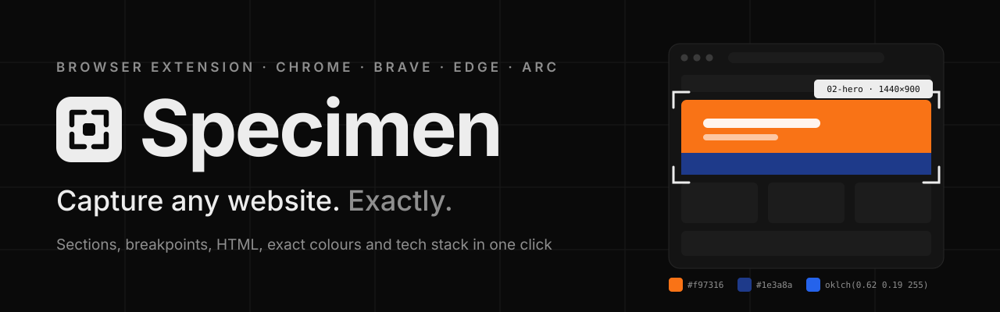
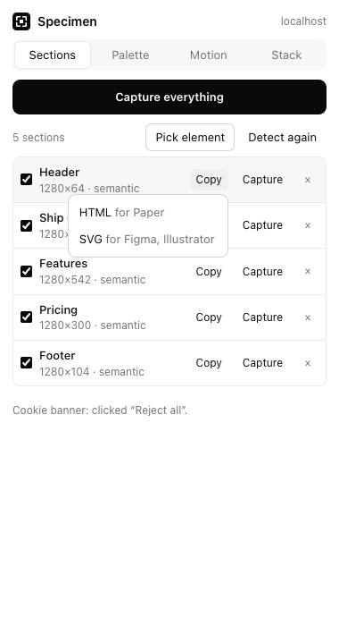
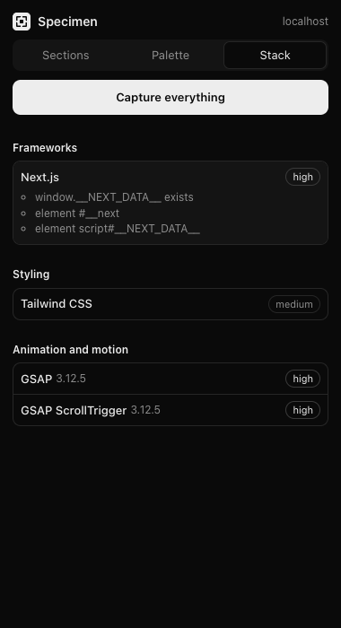
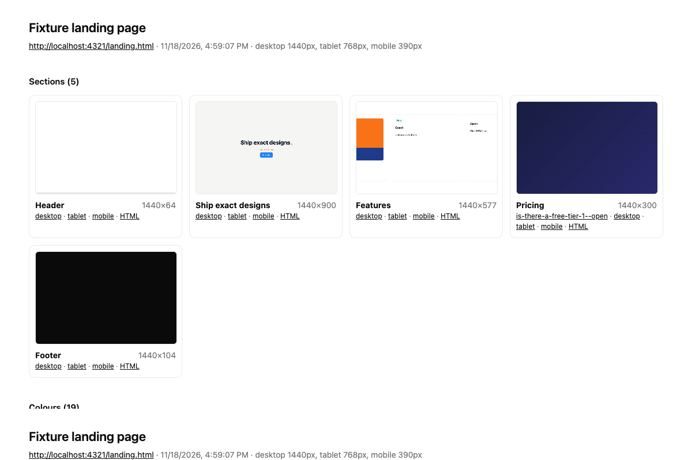

<p align="center">
  
</p>

<p align="center">
  
  
  
  
  
  
  
  
</p>

<h3 align="center">Capture any website section by section: screenshots at every breakpoint, standalone HTML, the exact colour palette and the tech stack, in one click and one bundle.</h3>

---

## Contents

- [What it does](#what-it-does)
- [Screenshots](#screenshots)
- [Quick start](#quick-start)
- [What's in a bundle](#whats-in-a-bundle)
- [How it works](#how-it-works)
- [Configuration](#configuration)
- [Repository map](#repository-map)
- [Testing](#testing)
- [Limits](#limits)
- [Privacy and security](#privacy-and-security)
- [Roadmap](#roadmap)
- [License](#license)

## What it does

Copying a design accurately usually means screenshots that miss half the page, an eyedropper that
gets colours slightly wrong, and guessing which libraries the site uses. Specimen opens in the
browser's side panel and reads the page the way the browser renders it.

| Feature | What you get |
|---|---|
| **Sections** | Finds the page's sections (header, hero, features, footer…) by their HTML tags, then by layout. You can untick, remove or capture one, or click **Pick element** to add any element on the page. Hovering a row outlines it on the page. |
| **Screenshots** | Full page and every section at desktop (1440px), tablet (768px) and mobile (390px), taken through the browser itself so a full-screen hero stays exactly one screen tall. Sticky headers are hidden in other sections' shots so they don't repeat. |
| **HTML** | Each section as a standalone `.html` file that looks like the original, with its images and fonts bundled, plus an MHTML snapshot of the whole page. |
| **Exact colours** | Every colour exactly as the site wrote it (`oklch(…)`, `color(display-p3 …)`, hex), its CSS variable names, what it's used for and where. Includes gradients, shadows, colours inside web components, translucent colours as they actually render, suggested roles (background, text, accent…), WCAG contrast for every text and background pair, and colours sampled from images and video. |
| **Eyedropper** | Pick any pixel on screen and see the page's exact colour, its variable and where it's used. |
| **Tech stack** | 41 frameworks, site builders, CSS systems and animation libraries (React, Next.js, Vue, Webflow, Framer, Tailwind, GSAP, Lenis, Lottie, Three.js…), with versions when the site exposes them and the evidence for each. |
| **Cookie banners** | Clicks "Reject all" or "Necessary only" before capturing, so the banner isn't in your screenshots. |

## Screenshots

<table>
  <tr>
    <td width="33%"></td>
    <td width="33%"></td>
    <td width="33%"></td>
  </tr>
  <tr>
    <td align="center"><sub>Sections</sub></td>
    <td align="center"><sub>Palette</sub></td>
    <td align="center"><sub>Stack (dark mode)</sub></td>
  </tr>
</table>

<p align="center">
  
  <br><sub>The report page inside every bundle</sub>
</p>

## Quick start

Needs Node.js 22+ and pnpm.

```bash
git clone https://github.com/ayushozha/specimen.git
cd specimen
pnpm install
pnpm build
```

1. Open `chrome://extensions` (or `brave://extensions`, `edge://extensions`).
2. Turn on **Developer mode** and click **Load unpacked**.
3. Choose `apps/extension/.output/chrome-mv3`.
4. Open any website and click the Specimen button in the toolbar. The side panel opens and analyses the page.
5. Click **Capture everything**. The bundle downloads as `<site>_<date>.specimen.zip`.

While the panel is connected, the browser shows a bar saying Specimen started debugging this
browser. That's expected: see [Privacy and security](#privacy-and-security). Closing the bar
cancels the capture.

For live reload while developing:

```bash
pnpm dev
```

## What's in a bundle

```
example.com_2026-11-18T14-02.specimen.zip
  index.html              browsable report: sections, colours, stack, failed steps
  manifest.json           page, breakpoints, sections with their size at each breakpoint, file list, errors
  palette.json            every colour with exact values, variables, usage, roles, contrast pairs
  stack.json              detected frameworks and libraries with versions and evidence
  page/
    full-desktop.png  full-tablet.png  full-mobile.png
    page.mhtml            the whole page as one file (opens offline in Chromium browsers)
  sections/02-hero/
    desktop.png  tablet.png  mobile.png
    02-hero.html          standalone HTML for the section
  design/
    palette.css           the site's colour variables and detected roles as CSS custom properties
    media-colors.json     key colours of each image and video
  assets/                 images and fonts used by the section HTML
```

Pages taller than 16,000px are saved as numbered full-page tiles.

## How it works

```
 Side panel (React)              Chromium adapter                     The page
 ──────────────────              ────────────────                     ────────
 Capture everything  ──►  chrome.debugger (DevTools Protocol)  ──►  isolated world
                           · viewport per breakpoint                 @specimen/core:
                           · screenshots beyond the viewport         sections, palette,
                           · every stylesheet, even cross-origin     stack, HTML, picker
                           · resources already loaded by the page
                           · MHTML snapshot
          ◄── zip (fflate): PNG + HTML + JSON + assets + report
```

- **`@specimen/core`** runs inside the page in an isolated JavaScript world, so the page's own
  scripts can't see or tamper with it. Framework detection reads page globals (like `window.gsap`)
  with one small self-contained function run in the page's own world.
- **The browser adapter** is an interface. Phase 1 implements it with the DevTools Protocol for
  Chromium browsers; Firefox and Safari adapters (phase 5) will use extension APIs instead.
- Images, fonts and stylesheets come from what the page already loaded, so Specimen needs no
  access to other sites and never downloads anything twice.
- Colours come from computed CSS, not from pixels, so they match the code exactly. Pixel sampling
  is used only for images and video.

## Configuration

Defaults live in one place: [`apps/extension/lib/config.ts`](apps/extension/lib/config.ts).

| Setting | Default | What it does |
|---|---|---|
| `breakpoints` | desktop 1440, tablet 768, mobile 390 | Viewports for screenshots |
| `scale` | 1 | Device pixel ratio of screenshots |
| `rejectCookies` | `true` | Click the most private option on cookie banners |
| `palette.groupThreshold` | 1 | Colours closer than this Delta E 2000 are grouped (exact values are always kept) |
| `mediaColors` | 5 | Colours sampled per image or video |
| `maxAssetBytes` | 200 MB | Stop bundling assets past this size |

A settings screen in the panel is on the roadmap.

## Repository map

```
packages/core/src/
  sections.ts       section detection and naming
  palette.ts        colours, variables, gradients, roles, contrast
  color.ts          colour parsing, gamut mapping, compositing, Delta E, median cut
  stack.ts          tech-stack rules (data) and detection
  serialize.ts      section → standalone HTML with inlined styles and shadow DOM
  prep.ts           lazy-load scrolling, cookie banners, fixed elements, media list
  picker.ts         element picker and on-page highlight
apps/extension/
  entrypoints/      side panel (React), background worker, core script for pages
  lib/capture.ts    the capture pipeline and bundle
  lib/chromium.ts   DevTools Protocol adapter
  lib/adapter.ts    browser adapter interface
  lib/report.ts     bundle report and palette.css
  assets/tokens.css UI colours (Pure mono)
tests/
  fixtures/         landing page used by the tests
  e2e/              Playwright tests: core in a real page, and the full extension
docs/assets/        banner, mark and screenshots
PLAN.md             full product plan and roadmap
```

## Testing

```bash
pnpm typecheck    # TypeScript for core and extension
pnpm test         # unit tests: colour maths, quantisation (Vitest)
pnpm test:e2e     # builds the extension, then runs the browser tests (Playwright)
```

The browser tests load the core into a real Chromium page and check sections, exact colour values
(including `oklch` and Display P3), contrast on gradients, stack detection, HTML serialisation and
cookie-banner handling. The extension test loads the built extension, runs **Capture everything**
on the fixture page and checks every file in the zip, including screenshot sizes and that section
HTML points at bundled assets. Run `npx playwright install chromium` once before the first run.

## Limits

- **Chromium browsers only for now.** Firefox and Safari are phase 5.
- **No motion yet.** Hover effects, animations and video recording are phase 2.
- **Content inside iframes from other sites** isn't captured.
- **Video protected by DRM** can't be captured, and Specimen doesn't get past CAPTCHAs or logins
  you haven't done yourself.
- Section HTML uses each element's computed size at the widest breakpoint, so it reproduces that
  layout exactly but isn't responsive.

## Privacy and security

- Everything runs locally in your browser. Specimen has no server, no account and no analytics.
  Bundles go straight to your downloads folder.
- The `debugger` permission lets Specimen use the DevTools Protocol on the tab you're capturing:
  it's what makes exact screenshots, viewport changes and reading cross-origin stylesheets
  possible. It attaches only when the panel is open on that tab and detaches when you close it or
  switch tabs. Chrome shows its debugging bar the whole time.
- Specimen asks for no host permissions. It reads assets the page has already loaded rather than
  fetching them again.
- Password fields are never copied into section HTML, and page scripts are removed from it.
- Use it on your own sites or sites you have permission to copy. Captured content belongs to its
  owners.

## Roadmap

| Phase | Scope | Status |
|---|---|---|
| 1 | Core and Chromium extension: sections, screenshots, HTML, palette, stack, bundle | ✅ Done |
| 2 | Hover and interaction detection, motion tracing, animation library adapters, frame-exact video | Next |
| 3 | Exports to Figma (plugin), Paper, Illustrator (SVG), Photoshop (PSD), After Effects, Lottie | Planned |
| 4 | Effect replication: rebuild unknown animations as CSS, GSAP or Motion code with a match score | Planned |
| 5 | Firefox and Safari, store releases | Planned |
| 6 | Desktop helper and CLI for very large pages and batch captures | Planned |

The full plan is in [PLAN.md](PLAN.md).

## License

No license has been chosen yet, so all rights are reserved for now.
