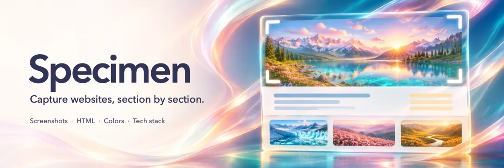
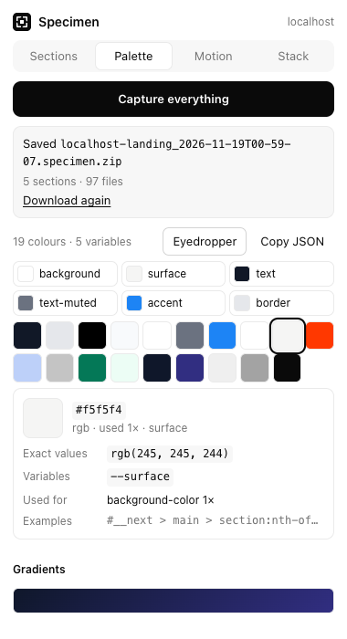
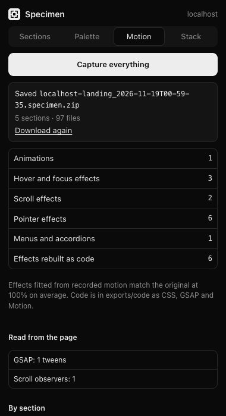
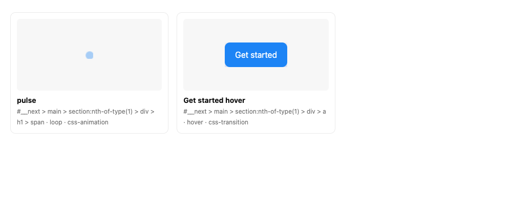

<p align="center">
  
</p>

<p align="center">
  
  
  
  
  
  
  
  
</p>

<h3 align="center">Capture any website section by section: screenshots at every breakpoint, standalone HTML, motion and hover effects, the exact colour palette and the tech stack. Rebuild it in Figma, Paper, Illustrator, Photoshop or After Effects, or as CSS, GSAP and Motion code.</h3>

---

## Contents

- [What it does](#what-it-does)
- [Screenshots](#screenshots)
- [Quick start](#quick-start)
- [What's in a bundle](#whats-in-a-bundle)
- [Exports](#exports)
- [Command line](#command-line)
- [How it works](#how-it-works)
- [Browser support](#browser-support)
- [Configuration](#configuration)
- [Repository map](#repository-map)
- [Testing](#testing)
- [Real-site results](#real-site-results)
- [Limits](#limits)
- [Privacy and security](#privacy-and-security)
- [License](#license)

## What it does

Specimen opens in the browser's side panel and reads a page the way the browser renders it. **Capture everything** records all of the below into one `.specimen.zip`.

| | |
|---|---|
| **Sections** | Finds the page's sections by their HTML tags, then by layout. Untick, remove or capture one, **Pick element** to add any element, **Copy** a section as HTML (for Paper) or SVG (for Figma and Illustrator). |
| **Screenshots** | Full page and every section at desktop (1440px), tablet (768px) and mobile (390px). Sticky headers are hidden in other sections' shots. |
| **HTML** | Each section as a standalone `.html` file with its images and fonts, plus an MHTML snapshot of the page. |
| **Exact colours** | Every colour as the site wrote it (`oklch(…)`, `color(display-p3 …)`, hex), its CSS variable, where it's used, roles, gradients, shadows, WCAG contrast for every text and background pair, colours from images and video, and an eyedropper. |
| **Motion** | Page-load and scroll recordings, every CSS animation captured frame by frame, scroll reveals and parallax traced and classified, GSAP timelines, ScrollTrigger, Lottie and AOS settings read from the page. |
| **Hover and interaction** | Every hover and focus effect, from CSS rules and JavaScript listeners: before and after styles, transition timing, a frame-exact clip and screenshots. Cursor followers, menus and accordions too. |
| **Effect replication** | Every effect as CSS, GSAP and Motion (React) code. Effects read from the page are exact; effects with no readable source are fitted to the recorded motion (cubic-bezier or spring) with a match score, and a preview page replays them. |
| **Tech stack** | 41 frameworks, site builders, CSS systems and animation libraries, with versions and evidence. |
| **Exports** | Figma plugin, Paper, SVG (Illustrator), layered PSD (Photoshop), After Effects script, Lottie, Adobe swatches, design tokens and Tailwind. See [Exports](#exports). |

## Screenshots

<table>
  <tr>
    <td width="33%"></td>
    <td width="33%"></td>
    <td width="33%"></td>
  </tr>
  <tr>
    <td align="center"><sub>Sections, with Copy for Paper and Figma</sub></td>
    <td align="center"><sub>Palette</sub></td>
    <td align="center"><sub>Motion (dark mode)</sub></td>
  </tr>
</table>

<p align="center">
  
  <br><sub>The report page inside every bundle</sub>
</p>

<p align="center">
  
  <br><sub>Rebuilt effects replayed from the generated CSS</sub>
</p>

## Quick start

Needs Node.js 23+ and pnpm.

```bash
git clone https://github.com/ayushozha/specimen.git
cd specimen
pnpm install
pnpm build:all
```

**Chrome, Brave, Edge, Arc, Opera, Vivaldi:** open `chrome://extensions`, turn on **Developer mode**, **Load unpacked** and choose `apps/extension/.output/chrome-mv3`. Click the Specimen button: the side panel opens and analyses the page. While it's connected, the browser shows a "started debugging this browser" bar (see [Privacy and security](#privacy-and-security)).

**Firefox 140+:** open `about:debugging#/runtime/this-firefox`, **Load Temporary Add-on** and pick `apps/extension/.output/firefox-mv3/manifest.json`. The button opens the sidebar.

**Safari (macOS):** `pnpm safari:project`, open `apps/safari/Specimen/Specimen.xcodeproj` in Xcode and run it, then turn on Specimen in Safari → Settings → Extensions (enable **Allow unsigned extensions** in the Develop menu for local builds). The button opens the panel in a small window.

**Figma:** in Figma, **Plugins → Development → Import plugin from manifest** and pick `apps/figma-plugin/manifest.json`. Run **Specimen** and choose a `.specimen.zip`.

## What's in a bundle

```
example.com-pricing_2026-11-18T14-02-11.specimen.zip
  index.html               browsable report
  manifest.json            page, breakpoints (and widths actually captured), sections, motion and export summary, errors
  palette.json  stack.json
  page/
    full-desktop.png  full-tablet.png  full-mobile.png  page.mhtml
    intro.mp4  scroll-desktop.mp4  pointer.mp4      load, scroll and pointer recordings
    motion.json  pointer.json                       hooks, libraries (GSAP, ScrollTrigger, Lottie), totals
  sections/02-hero/
    desktop.png  tablet.png  mobile.png  02-hero.html  scroll.mp4
    motion.json            CSS animations (keyframes, timing) and traced, classified motion
    motion/pulse-a1.mp4    animations captured frame by frame
    interactions.json      hover and focus: changed styles, transitions
    states/*--default.png *--hover.png *--hover.mp4 *--focus.png *--open.png
  design/  palette.css  media-colors.json
  exports/                 see below
  assets/                  images and fonts used by the section HTML
```

## Exports

| Target | File | What you get |
|---|---|---|
| **Figma** | `exports/figma.json` + the plugin | One frame per section with real frames, text, images and vectors; auto layout where it reproduces the page exactly; colour **variables** and styles; hover states as **component variants** wired with Smart Animate using the captured duration and easing; the screenshot as a hidden reference layer. |
| **Paper** | Copy → HTML in the panel | The section as HTML with inlined styles, pasted into Paper. |
| **Illustrator, Figma, Sketch** | `exports/svg/<section>.svg` or Copy → SVG | Editable SVG: boxes, gradients, borders, shadows, images and live text placed line by line. Matches the screenshot on more than 97% of pixels in the tests. |
| **Photoshop** | `exports/psd/<section>.psd` | A group per box, backgrounds as layers, images as exact crops, editable text layers, the screenshot as a hidden reference. |
| **After Effects** | `exports/after-effects/specimen.jsx` | Run it (File → Scripts → Run Script File): a comp per section with each animated element as a layer and keyframes with easing; endless animations loop. |
| **Lottie** | `exports/lottie/*.json` | Each animation and hover effect, playable in lottie-web, After Effects (LottieFiles), Figma and Rive. |
| **Code** | `exports/code/<section>.css`, `.gsap.js`, `.motion.tsx`, `.preview.html`, `replication.json` | Every effect as CSS, GSAP (with ScrollTrigger and CustomEase) and Motion for React, a preview page and match scores. |
| **Palette** | `exports/palette.ase`, `tokens.json`, `tailwind.theme.js` | Adobe swatches, W3C design tokens, a Tailwind theme. |

## Command line

Batch captures with the real extension, capture diffs and full video downloads.

```bash
node apps/cli/src/cli.ts capture https://example.com https://example.com/pricing --out captures --concurrency 2
```

```bash
node apps/cli/src/cli.ts diff before.specimen.zip after.specimen.zip --out diff
```

```bash
node apps/cli/src/cli.ts check captures/*.specimen.zip
```

```bash
node apps/cli/src/cli.ts media captures/example.com_2026-11-18T14-02-11.specimen.zip --out media
```

- `capture` takes URLs or `--urls file.txt`, runs **Capture everything** for each and never overwrites a file.
- `diff` reports added and removed sections, a pixel diff of every section with highlighted images, colour and CSS variable changes, tech-stack changes and motion totals (`diff/index.html`, `diff/diff.json`).
- `check` reports a bundle's errors, stack and motion, and how closely each SVG export matches its screenshot. Bundles from others are opened with scripts off and no network.
- `media` downloads the original videos a capture references; HLS and DASH streams go through `ffmpeg`.

Run `npx playwright install chromium` once before the first capture.

## How it works

```
 Panel (React)               Adapter                                  The page
 ─────────────               ───────                                  ────────
 Capture everything  ──►  Chromium: DevTools Protocol            ──►  isolated world: @specimen/core
                          Firefox, Safari: scripting, tabs,           sections · palette · stack · HTML
                          windows (no DevTools)                       layout tree · motion tracer · hover
                                                                 ──►  page world: library probes, deep-mode
                                                                      hooks (listeners, IntersectionObserver)
          ◄── @specimen/exporters: Figma · SVG · PSD · AE · Lottie · ASE · tokens · CSS/GSAP/Motion code
          ◄── zip (fflate) with a report
```

- **Deep mode.** Capture everything reloads the page with small hooks installed before the site's own scripts, to record which elements react to the pointer and which are watched for scrolling into view. The reload is recorded as the page-load video.
- **Frame-exact motion.** CSS animations and hover transitions are paused and stepped frame by frame through the Web Animations API, with one screenshot per frame, so clips are smooth at any frame rate.
- **Exact colours.** Colours come from computed CSS, not pixels. Pixels are sampled only for images and video.
- **Replication.** Effects read from the page (CSS keyframes, transitions, GSAP settings) are copied exactly. Motion with no readable source is fitted to a named easing, a cubic-bezier or a spring, scored against the recording, and replayed in a browser by the tests.

## Browser support

| | Chromium (Chrome, Brave, Edge, Arc, Opera, Vivaldi) | Firefox 140+ | Safari (macOS) |
|---|---|---|---|
| Panel | Side panel | Sidebar | Small window |
| Screenshots | DevTools, exact | `tabs.captureTab`, exact | Scroll and stitch |
| Breakpoints | Device emulation (touch, mobile) | Window resize, within screen limits | Window resize, within screen limits |
| Hover | Real pointer | Simulated from the page's `:hover` rules and events | Same as Firefox |
| Videos | Load, scroll, pointer, frame-stepped clips | Frame-stepped clips | Screenshots only |
| MHTML | Yes | No | No |
| Site access | None needed (DevTools) | Asked once, when a capture starts | Asked once, when a capture starts |

Every bundle's `manifest.json` records the width each breakpoint was actually captured at, and anything a browser couldn't do appears under **Steps that failed** in the report.

## Configuration

Defaults are in one file: [`apps/extension/lib/config.ts`](apps/extension/lib/config.ts): breakpoints, screenshot scale, cookie-banner handling, palette grouping, motion limits (animations, frames, hover probes, toggles), frame rate, recording lengths and safety limits on page height, sections and asset size.

## Repository map

```
packages/core/          runs in the page: sections, palette, stack, HTML, layout tree, motion, hover, hooks
packages/exporters/     pure TypeScript: SVG, Lottie, After Effects, ASE, tokens, Figma document, easing fits, code
apps/extension/         WXT + React panel, DevTools and extension-API adapters, capture pipeline, PSD, video encoding
apps/figma-plugin/      Figma plugin that imports a .specimen.zip
apps/safari/            Xcode project made by `pnpm safari:project`
apps/cli/               batch capture, diff, media download
tests/                  fixture pages (including a hostile one) and Playwright tests
PLAN.md                 product plan, decisions and what changed from it
```

## Testing

```bash
pnpm typecheck
pnpm test
pnpm test:e2e
```

- **Unit tests (40):** colour maths, median cut, motion maths, easing fits (named, bezier, spring), every exporter, generated-code safety, and the Figma importer against a recording stand-in for Figma's API.
- **Browser tests (33):** the core in a real page; the full extension capturing the fixture; every export opened the way its tool would (SVG pixel-compared to the screenshot, PSD parsed, Lottie played in lottie-web, the After Effects script parsed); generated CSS replayed and compared to the original curve; the Firefox/Safari code path run inside Chromium; the CLI's batch capture, diff and HLS download; and a hostile page that tries to inject scripts, steal typed values, get user activation and escape file paths.

Run `npx playwright install chromium` once. The Firefox build is checked with `npx web-ext lint --source-dir apps/extension/.output/firefox-mv3` (0 errors) and the Safari app with `xcodebuild`.

## Real-site results

Captured with the real extension through the CLI (`specimen capture`, headless Chromium, 1440px desktop) and scored with `specimen check` on 2026-11-20. "SVG match" is the share of pixels in each section's SVG export, opened from the bundle, that match the section's real screenshot.

| Site | Time | Sections | Stack detected | Hover effects | SVG match (per section) |
|---|---|---|---|---|---|
| linear.app | 166s | 9 | React, Next.js, styled-components | 25 | 94–99% |
| tailwindcss.com | 85s | 7 | React, Next.js 16.2, Tailwind | 12 | 93–99% |
| vercel.com | 80s | 6 | React, Next.js 16.5 canary, Tailwind | 20 | 86–99% |
| framer.com | 116s | 4 | React, Framer | 12 | 84–99% |
| gsap.com | 87s | 8 | GSAP 3.15 + ScrollTrigger | 15 | 80–97% |
| stripe.com | 196s | 12 | React, Next.js 14.2.32, Three.js 178 | 13 | 85–98%; header 54% |

Each section is scrolled through so its reveals play, one-off animations finish, and the page is frozen (CSS animations and the page's own timers) while its screenshot, HTML and layout are read. Stripe's header is transparent and its animated hero shows through it, which the header's own layers can't reproduce.

Testing on real sites found and fixed: colour values that crashed the parser (apple.com); scroll-driven animations that crashed frame stepping, lazy content moving sections, pinned sections, a dialog left open over later screenshots, uncached fonts, and page-styled inline SVGs turning black (stripe.com); hundreds of unused fonts in exports (framer.com); section names losing spaces (linear.app); oversized wrapper blocks, doubled text over pixel layers and shadows repainting translucent backgrounds (tailwindcss.com); and poorly fitted effects written as code.

## Limits

- Firefox and Safari can't emulate mobile devices; breakpoints there are window widths, limited by the screen and the browser's minimum window size.
- JavaScript animation loops (requestAnimationFrame) are recorded as video and traced, not rebuilt as code; WebGL and canvas effects are recorded only.
- Content inside cross-origin iframes isn't captured. DRM video can't be captured, and Specimen doesn't get past CAPTCHAs or logins.
- Section HTML and design exports reproduce the widest breakpoint's layout exactly; they aren't responsive.
- Transparent elements show whatever is behind them in the screenshot (another section's animation, say); their own layers can't reproduce that.
- Figma, Photoshop and After Effects imports are tested against their file formats and APIs, not inside those apps.

## Privacy and security

- Everything runs locally. No server, no account, no analytics; bundles go to your downloads folder.
- **Chromium** uses the `debugger` permission (the DevTools Protocol) on the tab you capture, only while the panel is open on it. No host permissions.
- **Firefox and Safari** ask for access to sites when you start a capture, to read cross-origin stylesheets and assets the page already uses.
- Generated files are treated as untrusted page content:
  - Every generated HTML file has a Content-Security-Policy that blocks all scripts.
  - Scripts, event handlers and `javascript:` links (including ones split by tabs or newlines) are removed.
  - Page text in generated code stays inside comments and strings.
  - Typed form values and password fields are never saved.
- Page code never gets user activation from Specimen, and code run in the page's own world has a time limit.
- The CLI only downloads http(s) media, limits ffmpeg to network protocols, and never writes outside its output folder, even for bundles from someone else.
- Use it on your own sites or sites you have permission to copy. Captured content belongs to its owners.

## License

No license has been chosen yet, so all rights are reserved for now.
